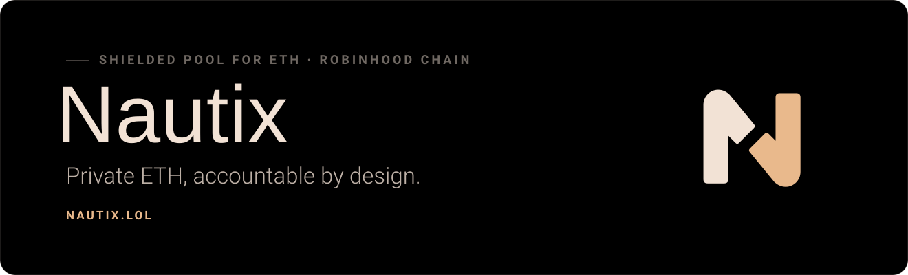
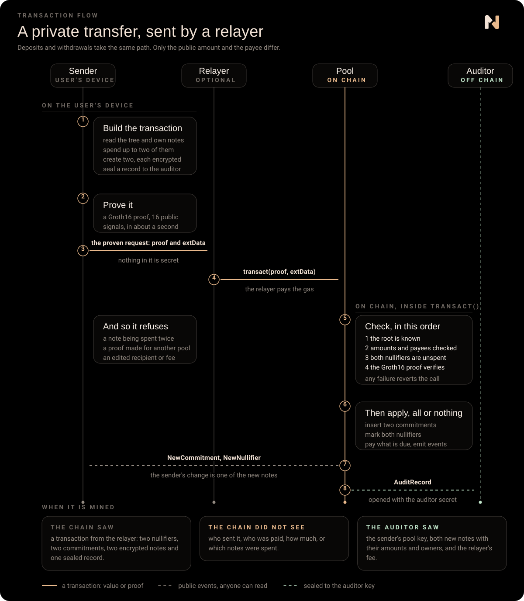

<p align="center">
  
</p>

<h1 align="center">Nautix Contracts</h1>

<p align="center">
  <strong>Smart contracts, proving circuit and tooling for the Nautix shielded pool.</strong><br>
  Deposit in public. Hold and send in private. Withdraw whenever you like.
</p>

<p align="center">
  <a href="LICENSE"></a>
  <a href="foundry.toml"></a>
  <a href="circuits/transact.circom"></a>
  <a href="#how-it-works"></a>
  <a href="../../actions/workflows/ci.yml"></a>
</p>

<p align="center">
  <a href="https://nautix.lol">Website</a> |
  <a href="https://x.com/nautixrbh">X</a> |
  <a href="#architecture">Architecture</a> |
  <a href="#getting-started">Getting started</a> |
  <a href="#security-considerations">Security</a> |
  <a href="SECURITY.md">Reporting a vulnerability</a>
</p>

<details>
<summary>Table of contents</summary>

- [Overview](#overview)
- [Architecture](#architecture)
- [How it works](#how-it-works)
- [Transaction flow](#transaction-flow)
- [Repository layout](#repository-layout)
- [Getting started](#getting-started)
- [Testing](#testing)
- [Proving key and trusted setup](#proving-key-and-trusted-setup)
- [Deploying](#deploying)
- [Auditing a pool](#auditing-a-pool)
- [Client library](#client-library)
- [Configuration reference](#configuration-reference)
- [Security considerations](#security-considerations)
- [Performance](#performance)
- [Contributing](#contributing)
- [License](#license)

</details>

## Overview

Nautix is a shielded pool for ETH on Robinhood Chain. ETH enters through a public deposit and exists inside the pool only as notes that solely their owner's keys can open. It moves between users as zero-knowledge proofs and leaves through a public withdrawal. No operator holds a balance for anyone, only new deposits can be paused, and there is no upgrade path.

Private is not the same as unaccountable. Every proof carries a record sealed to one auditor key. The auditor can read every transfer, rebuild every balance and reconcile the total against the pool. The auditor cannot spend a wei, pause anything or change the code.

| Property | How it holds |
| --- | --- |
| Private balances | A note is `(amount, owner public key, blinding)`. The chain stores only its commitment. |
| No double spend | Spending a note publishes a nullifier that only its owner can compute. |
| No operator | Keys derive from one wallet signature, and a balance is rebuilt from public events. |
| Relayers are optional | A relayer submits a finished transaction for a fee fixed inside the proof. It cannot change a field. |
| Accountable | Every transaction seals a record to the auditor key, and the circuit refuses a false one. |
| Immutable | The verifier, the hasher, the tree depth and the root history are fixed in the constructor. |
| One circuit | Deposits, transfers and withdrawals all use `transact.circom`. |

| | |
| --- | --- |
| Proof system | Groth16 over BN254, made with [snarkjs](https://github.com/iden3/snarkjs) |
| Circuit | `Transact(24)`: 40,092 constraints, 16 public signals, 62 private inputs |
| Notes per transaction | Spends up to two, creates exactly two |
| Commitment tree | Depth 24, Poseidon; the last 1,000 roots are accepted |
| Amounts | Below 2^96 wei per note |
| Auditor key change | 7 days of public delay |
| Solidity | 0.8.28 |

> **Status.** This is test-network software. The contracts have been exercised end to end on a local node and on a live test network with real proofs. They have **not** been audited by an outside firm. See [Security considerations](#security-considerations).

## Architecture


| Component | File | Role |
| --- | --- | --- |
| `Pool` | [`src/Pool.sol`](src/Pool.sol) | Holds the ETH, the commitment tree and the spent-nullifier set. Checks each proof, updates the tree and pays out. |
| `Registry` | [`src/Registry.sol`](src/Registry.sol) | Maps a wallet address to its shielded keys. No owner, no funds. |
| `Hasher` | [`src/Hasher.sol`](src/Hasher.sol) | `Poseidon(2)` in inline assembly, generated from the circuit library's constants. |
| `Groth16Verifier` | [`src/Verifier.sol`](src/Verifier.sol) | Generated by snarkjs from the proving key. |
| `Curve` | [`src/Curve.sol`](src/Curve.sol) | Internal library: is a point a valid auditor key on BabyJubJub. |
| Circuit | [`circuits/transact.circom`](circuits/transact.circom) | The proving circuit behind every transaction. |
| Client and tooling | [`scripts/lib/`](scripts/lib) | Protocol mathematics, keys, note encryption, the client and the auditor's ledger. Plain `BigInt`, so it runs in Node and in a browser. |

The on-chain part is small on purpose. Everything that needs a secret, the keys, the notes and the proving, runs on the user's device.

## How it works

### Notes, commitments and nullifiers

```
public key = Poseidon(private key)
note       = (amount, owner public key, blinding)
commitment = Poseidon(TAG_NOTE, amount, public key, blinding)
nullifier  = Poseidon(TAG_NULLIFIER, commitment, leaf index, private key)
```

The tree stores commitments. A nullifier is derived from the commitment, the leaf it sits in and the owner's private key, so only the owner can produce it and nobody can tell from a nullifier which note was spent. The domain tags keep hashes of different kinds from colliding: a commitment can never double as a nullifier or as a keystream word.

### What the proof shows

One transaction spends up to two notes and creates exactly two. Its Groth16 proof shows, and nothing more:

1. every input note that carries value is a leaf of the tree under a published root;
2. the prover knows the private key that owns every input note;
3. the nullifiers are derived correctly and are distinct;
4. inputs plus the public amount equal the outputs;
5. every output amount is below 2^96, so no sum wraps the field;
6. the auditor ciphertext really seals the sender key and both outputs;
7. the statement is bound to `extDataHash`.

### The 16 public signals

The pool assembles these for the verifier, in this order. It computes the public amount itself, so a prover cannot choose it.

| Index | Signal | Where it comes from |
| --- | --- | --- |
| 0 | `root` | the proof; must be one of the pool's known roots |
| 1 | `publicAmount` | `extAmount - fee`, in the field |
| 2 | `extDataHash` | the pool, from `extData`, `block.chainid` and its own address |
| 3 to 4 | `inputNullifier` | the proof |
| 5 to 6 | `outputCommitment` | the proof |
| 7 to 8 | `auditorPubKey` | the pool's auditor key in force |
| 9 to 10 | `auditEphemeral` | the proof |
| 11 to 15 | `auditCipher` | the proof |

`extDataHash` is the keccak256 of the recipient, the external amount, the relayer, the fee, the two encrypted notes, the chain id and the pool's address, reduced into the field. A proof is therefore valid for one pool on one chain, and for one set of external data only.

### The auditor's copy

Each transaction also publishes a sealed record. The sender draws a nonce, publishes `R = nonce * G`, and masks five words with a keystream keyed on `nonce * auditorKey`: the sender's public key, and the amount and owner of each new note. All of this is constrained by the circuit, so the record decrypts to the truth or the proof does not exist. The first nullifier in the keystream makes it unique to the transaction.

The auditor holds the secret half of the key, opens every record, and rebuilds every balance from the records and the public events. The auditor key grants no on-chain right of any kind.

### Keys and encrypted notes

- **Keys come from one wallet signature.** The message names the chain. Its hash seeds a spending key (`Poseidon` public key) and an X25519 view key, so there is nothing extra to back up: the same wallet always gives the same private balance.
- **A new note is sealed to its owner's view key** with X25519, HKDF-SHA256 and AES-256-GCM, and published with the transaction. A recipient needs nothing but the chain to find its money, and accepts a decrypted note only if its commitment matches the one on chain.
- **The `Registry`** lets a wallet publish its two public keys, so a payer only needs the recipient's ordinary address.

## Transaction flow



The three actions share one path. Only the public amount and the payee differ.

| | Deposit | Private transfer | Withdrawal |
| --- | --- | --- | --- |
| `extAmount` | positive | zero | negative |
| `msg.value` | the deposit | zero | zero |
| Who sends it | the wallet that pays the ETH | any wallet or relayer | any wallet or relayer |
| Amount on chain | public | private | public |
| Recipient on chain | the note's owner is private | private | the withdrawal address |
| Sender on chain | the depositing wallet | whoever submitted it | whoever submitted it |
| Nullifiers, commitments, encrypted notes, sealed record | public | public | public |

## Repository layout

```
.
├── circuits/
│   └── transact.circom          the proving circuit
├── ceremony/                    public record of a proving key
├── deployments/                 one deployment record per chain, written by the deploy tools
├── docs/                        the diagrams of this README
├── lib/forge-std/               Foundry's test library, vendored (v1.17.0)
├── script/
│   └── Deploy.s.sol             deployment with read-back checks
├── scripts/
│   ├── build-circuit.mjs        compile the circuit
│   ├── circuit-report.mjs       static facts about the compiled circuit
│   ├── gen-hasher.mjs           src/Hasher.sol
│   ├── setup-proving-key.mjs    proving key, verifying key, src/Verifier.sol, ceremony record
│   ├── gen-auditor-key.mjs      the pool's auditor key pair
│   ├── gen-fixtures.mjs         proofs and other fixtures for the Foundry tests
│   ├── record-deployment.mjs    complete a deployment record from the receipts
│   ├── smoke-test.mjs           the whole flow, on a local node or on a live network
│   ├── audit.mjs                the auditor's ledger
│   └── lib/                     protocol.mjs, witness.mjs, keys.mjs, notes.mjs, client.mjs, auditor.mjs, chain.mjs
├── src/
│   ├── Pool.sol
│   ├── Registry.sol
│   ├── Hasher.sol               generated
│   ├── Verifier.sol             generated
│   └── Curve.sol
├── test/                        Foundry tests, fixtures and mocks
├── tests/                       Node tests: the circuit and the protocol mathematics
├── foundry.toml
└── package.json
```

`forge-std` is vendored as its sources and licences, so that `forge test` runs from a fresh clone without a network and against the version the suite was validated with. Its own tests are not part of the repository.

## Getting started

### Prerequisites

| Tool | Version used for this release | Needed for |
| --- | --- | --- |
| [Foundry](https://www.getfoundry.sh/introduction/installation) (`forge`, `anvil`) | 1.8.1 | building, the Foundry tests, the local node |
| [Node.js](https://nodejs.org) | 22 | everything under `scripts/` and `tests/` |
| [circom](https://github.com/iden3/circom) | 2.2.3 | compiling the circuit |
| Rust, CMake and a C++ compiler | | building `circom` |

### The contracts on their own

The Foundry suite runs from a fresh clone with Foundry alone. It uses proofs that are already in the repository, so it needs no Node, no circuit compiler and no proving key.

```bash
forge build
forge test
```

```text
Ran 6 test suites ... 74 tests passed, 0 failed, 0 skipped (74 total tests)
```

### The full tooling

```bash
npm ci

# The circuit compiler, installed next to the repository. build-circuit.mjs looks there first.
cargo install circom --git https://github.com/iden3/circom.git --tag v2.2.3 --root .tools --locked

# build/zk: the r1cs, the wasm witness calculator and the symbol file.
node scripts/build-circuit.mjs

# A proving key for development, and src/Verifier.sol for it.
node scripts/setup-proving-key.mjs --network local

# The proofs for the Foundry tests, made with the new key.
node scripts/gen-fixtures.mjs

# 37 Node tests, then 74 Foundry tests.
npm test

# The whole flow on a local node: 38 checks.
node scripts/smoke-test.mjs
```

`setup-proving-key.mjs --network local` downloads the public phase-1 file (about 72 MB), makes a proving key and overwrites `src/Verifier.sol`. The committed proofs were made with a different key, which is why `gen-fixtures.mjs` has to follow. A local key is for development only: never deploy a pool with it, and do not commit a verifier or fixtures made from it.

`src/Hasher.sol` and `test/FixtureData.sol` are generated as well. `node scripts/gen-hasher.mjs` and `node scripts/gen-fixtures.mjs --reuse` rewrite them, and on an unchanged repository both reproduce the committed files byte for byte. Compiling the circuit with circom 2.2.3 reproduces the digests recorded in `ceremony/testnet.json`.

## Testing

| Layer | Command | What it covers |
| --- | --- | --- |
| Foundry, state rules | `forge test --match-contract PoolTest` | 29 tests on the pool's own rules, most with a verifier that accepts everything so that each test states one rule of the pool itself: the tree and its root history, limits, pausing, held payments, reentrancy, the auditor key, ownership. |
| Foundry, real proofs | `forge test --match-contract PoolProofsTest` | 21 tests with real Groth16 proofs on a fixed storyline: replay, tampering with any field, proofs made for another pool, chain or auditor key. |
| Foundry, primitives | `forge test --match-contract 'HasherTest\|CurveTest\|VerifierTest\|RegistryTest'` | 24 tests: Poseidon against circomlibjs, auditor keys that must be accepted or refused, the verifier against changed signals, the registry. |
| Circuit | `node --test tests/circuit.test.mjs` | 30 tests. Each builds real circuit inputs and asks whether a witness exists: happy paths, then every attack from creating money to lying to the auditor. |
| Protocol mathematics | `node --test tests/protocol.test.mjs` | 7 tests against independent references: circomlibjs for Poseidon, known-answer vectors for the tree, the subgroup structure of BabyJubJub. |
| End to end | `node scripts/smoke-test.mjs` | Deploys the four contracts on a local node and runs register, deposit, a relayed transfer, a withdrawal, a refused replay and tampered requests, a restore from keys alone, and the auditor's reconciliation. 38 checks. |

The end-to-end test can also run against a recorded deployment, with small real transactions:

```bash
DEPLOYER_KEY=0x... node scripts/smoke-test.mjs --network testnet
```

It needs `deployments/<chain id>.json` and `ceremony/<network>-auditor-key.json`. The test wallets it creates are kept in `build/`, which is never committed, so that no test ETH is left in wallets nobody can open.

## Proving key and trusted setup

Groth16 needs a proving key and a verifying key that come out of a trusted setup. This repository ships three things made with one key:

- `src/Verifier.sol`, generated from the proving key;
- `ceremony/testnet.json`, the public record of that key: the digests of the circuit, the phase-1 file, the contribution and the final key, and the beacon that was applied;
- the proofs in `test/fixtures/proofs.json`.

The proving key itself (`build/keys/transact.zkey`, about 55 MB) is not part of the repository.

`scripts/setup-proving-key.mjs` makes a key in four steps:

1. **Phase 1.** The public Hermez powers-of-tau file, `powersOfTau28_hez_final_16.ptau`, is downloaded and checked against the checksum published by snarkjs.
2. **Phase 2, contribution.** One contribution with 64 random bytes from the operating system, used once and never written anywhere.
3. **Phase 2, beacon.** The hash of a block of the target chain mined after the contribution was written to disk, so that nobody, not even the contributor, could have chosen it. `--network local` takes random bytes instead, and is for development only.
4. **Checks.** The finished key is verified against the circuit and phase 1, in the process and again by the snarkjs command line. A proof made with it must verify, and must fail once a public signal is changed.

The script then writes the key, the verifying key, `src/Verifier.sol` and `ceremony/<network>.json`. It refuses to run twice for the same network: a new key needs a new verifier, new fixtures and a new pool.

Phase 2 of the shipped key had one contributor. That is fine for a test network. Before a deployment that holds real money, more contributors should be added between the contribution and the beacon.

## Deploying

Networks are declared in two places: `NETWORKS` in [`scripts/lib/chain.mjs`](scripts/lib/chain.mjs), used by every tool that reads a deployment, and `NETWORKS` in [`scripts/setup-proving-key.mjs`](scripts/setup-proving-key.mjs), which also needs an RPC for the beacon block. Both ship with Robinhood Chain testnet. Add a network by adding an entry to both.

```bash
# The auditor key pair. Only the public half goes on chain. Keep the file private.
node scripts/gen-auditor-key.mjs --network <network>

export RPC_URL=<rpc endpoint>
export DEPLOYER_KEY=<deployer private key>
export AUDITOR_FILE=./ceremony/<network>-auditor-key.json
export CEREMONY_RECORD=./ceremony/<network>.json

# Simulate only.
forge script script/Deploy.s.sol --rpc-url "$RPC_URL"

# Deploy, then verify the source on a Blockscout explorer.
forge script script/Deploy.s.sol --rpc-url "$RPC_URL" --broadcast --slow --verify \
  --verifier blockscout --verifier-url <explorer api>

# Complete the record from the receipts.
node scripts/record-deployment.mjs --network <network>
```

| Setting | Meaning | Default |
| --- | --- | --- |
| `DEPLOYER_KEY` | private key of the deployer | required |
| `RPC_URL` | RPC endpoint of the network | required |
| `AUDITOR_FILE` | file made by `gen-auditor-key.mjs` | required |
| `ROOT_HISTORY_SIZE` | number of recent roots a proof may be built on | `1000` |
| `MAX_DEPOSIT_ETH` | largest deposit | `0.1` |
| `POOL_CAP_ETH` | largest `totalHeld` | `5` |
| `OWNER` | first owner of the pool | the deployer |
| `CEREMONY_RECORD` | proving-key record, noted in the deployment record | none |

`Deploy.s.sol` deploys `Hasher`, `Groth16Verifier`, `Pool` and `Registry`, then reads everything back and stops on any mismatch: the hasher computes the circuit's Poseidon, the pool starts from the empty root of depth 24, the auditor key, the limits and the owner are the ones asked for, and the pool points at the verifier and the hasher deployed with it. It writes `deployments/<chain id>.json`.

`record-deployment.mjs` adds what only the receipts know, the transactions, their blocks and gas. It then reads the chain to confirm that code is at every address, and the explorer to confirm that the source is verified. It exits with code 2 while the explorer is still catching up, so run it again.

Deployment records hold addresses, and this repository publishes none: `deployments/*.json` is ignored by git.

## Auditing a pool

`scripts/audit.mjs` is the auditor's tool. It reads a pool's public events, opens every copy sealed to the auditor key, rebuilds each participant's balance and checks that the balances add up to the pool's `totalHeld`.

```bash
node scripts/audit.mjs --network testnet                     # one line per record, then the balances
node scripts/audit.mjs --network testnet --format csv        # one row per payment
node scripts/audit.mjs --network testnet --format json       # everything, for another tool
node scripts/audit.mjs --network testnet --key off-line.json # a key file kept elsewhere
```

The exit code is 0 only when every record was readable and the ledger reconciles with the pool. A record sealed to another key is counted as unreadable and fails the run.

## Client library

[`scripts/lib/`](scripts/lib) is the client that the tests and the tools are built on. It keeps nothing on a server: a new object with only a set of keys rebuilds its balance from the chain.

| Module | Exports |
| --- | --- |
| `protocol.mjs` | Poseidon, BabyJubJub, the commitment tree, note and nullifier derivation, the auditor record, `buildTransaction` |
| `keys.mjs` | `deriveKeys`, `deriveKeysFromLabel` |
| `notes.mjs` | `encryptNote`, `decryptNote` |
| `witness.mjs` | `prove`, `verify`, `witnessOf`, `circuitAccepts` |
| `client.mjs` | `Client`, `hashExt`, `poolProofOf` |
| `auditor.mjs` | `readLedger`, `describe`, `toCsv`, `ledgerHash` |
| `chain.mjs` | `NETWORKS`, `clients`, `contracts`, `deploy` |

`scripts/smoke-test.mjs` is the reference use of the client:

```js
const keys = await deriveKeys(sign, chainId);        // one wallet signature
const client = new Client({ publicClient, walletClient, account, deployment, keys, prove });

await client.register();                             // publish this wallet's shielded address
await client.deposit(parseEther("0.05"));            // ETH in, as one note
await client.transfer(to, parseEther("0.03"), relay); // private, sent by the relayer
await client.withdraw(recipient, parseEther("0.02"), relay);
```

`client.prepare()` builds and proves a transaction and simulates it, without sending anything. It returns a request that a wallet or a relayer can send as it is. Whoever sends it changes nothing: recipient, amount, relayer and fee are bound by the proof.

## Configuration reference

| Pool parameter | Set by | Value of the shipped fixtures |
| --- | --- | --- |
| `levels` | constructor, must equal the depth compiled into the circuit | 24 |
| `rootHistorySize` | constructor, `ROOT_HISTORY_SIZE` | 1000 |
| `maxDeposit` | constructor, `MAX_DEPOSIT_ETH`; `setLimits` later | 0.1 ETH |
| `poolCap` | constructor, `POOL_CAP_ETH`; `setLimits` later | 5 ETH |
| `auditorKey` | constructor; `proposeAuditor` then `activateAuditor` | per deployment |
| `owner` | constructor; `transferOwnership` then `acceptOwnership` | the deployer |
| `AUDITOR_DELAY` | constant | 7 days |
| `AMOUNT_LIMIT` | constant | 2^96 wei |

## Security considerations

### The owner is limited on purpose

| The owner can | The owner cannot |
| --- | --- |
| pause new deposits (`setDepositsPaused`) | move ETH, or stop transfers and withdrawals |
| change the deposit limit and the pool cap (`setLimits`) | touch funds that are already inside |
| propose an auditor key (`proposeAuditor`), which anyone can activate after 7 days (`activateAuditor`) | replace the auditor key without the delay |
| hand over ownership in two steps (`transferOwnership`, `acceptOwnership`) | upgrade the code, or change the verifier, the hasher or the tree depth |

### What protects what

- **Replay.** A nullifier can be spent once, on this pool and on this chain. A second proof for the same note publishes the same nullifier and is refused.
- **Tampering.** Recipient, external amount, relayer, fee and the two encrypted notes are hashed into `extDataHash`, a public signal. Changing any of them invalidates the proof.
- **Money from nothing.** Value conservation, the 2^96 range on amounts and the Merkle membership are circuit constraints. The contract enforces the range again, and pays out of `totalHeld`, which cannot go negative.
- **A public auditor record.** With the identity or a torsion point as auditor key the sealed record would be readable by anyone. `Curve.isAuditorKey` refuses such keys at construction and on every proposal.
- **A payee that refuses ETH.** Payouts get 50,000 gas. If a payee does not accept, the amount waits in `owed` for it to `claim()`, and the transaction is not undone. `transact` and `claim` carry a reentrancy lock.
- **ETH forced in.** The pool has no receive function. ETH pushed in by `selfdestruct` stays there for good and changes no balance.

### Known limitations

- **No independent audit.** The suite is thorough, but it is the authors' own.
- **A one-party phase 2.** See [Proving key and trusted setup](#proving-key-and-trusted-setup).
- **Deposits and withdrawals are public**, with amount and address. Privacy holds for what happens inside the pool, and a small pool offers a small anonymity set.
- **The auditor sees every transfer.** That is the design. Whoever holds the auditor secret of a pool can read every record sealed to that key.
- **Keys are a signature.** Whoever obtains the signature can read and spend the private balance. The message is fixed and names the chain, and it should only be signed on software that is trusted.
- **A relayer sees where a request comes from** on the network. The request itself carries no key, and for a transfer no amount.

Found something? Please report it privately: [SECURITY.md](SECURITY.md).

## Performance

Measured with solc 0.8.28, optimizer at 200 runs, on a local node.

| | |
| --- | --- |
| Deposit | about 1.13 million gas |
| Private transfer through a relayer | about 1.12 million gas |
| Withdrawal through a relayer | about 1.17 million gas |
| `verifyProof` alone | about 296,000 gas |
| `poseidon` alone | about 25,000 gas, called 24 times per transaction |
| Deploying the four contracts | about 7.9 million gas |
| Proving and verifying one transaction | 1.1 to 1.3 s in Node.js 22, over two runs on the machine this release was verified on |

| Contract | Deployed bytecode |
| --- | --- |
| `Hasher` | 16,016 bytes |
| `Pool` | 8,905 bytes |
| `Groth16Verifier` | 2,762 bytes |
| `Registry` | 526 bytes |

## Contributing

Read [CONTRIBUTING.md](CONTRIBUTING.md) before a pull request. It lists the commands, the rule about generated files, and what must never be committed.

## License

The contracts, the circuit and the tooling are released under the [MIT License](LICENSE). Parts of the tree come from other projects under their own terms, among them the generated verifier and the circuit templates; [THIRD_PARTY_NOTICES.md](THIRD_PARTY_NOTICES.md) records them.

## Disclaimer

This software is provided as is, without warranty of any kind. It has not been audited by an outside firm. Do not use it for funds you cannot afford to lose.

Nautix is an independent project. It is not affiliated with or endorsed by Robinhood.
